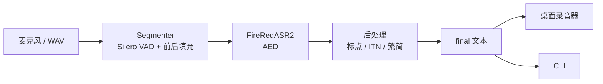

# FireRedASR2S

> 版本：v1.9
> **精度优先**的粤语 / 普通话 / 英文句级语音转写系统，附独立桌面录音器。

---

## 1. 项目状态

| 模块 | 状态 |
| --- | --- |
| POC 后端（WebSocket + CLI） | 可用；真实 FireRedASR2 模型，默认 AED |
| 句级切分 | Silero VAD + pre/post roll + 句段合并 |
| 后处理 | 标点 + 保守 ITN + OpenCC 繁简 |
| 桌面录音器 | PyQt6 窗口；麦克风 → WebSocket → 逐句显示 |
| 后端镜像 | Dockerfile；默认把 AED/Silero/标点烤进镜像 |
| 打包 | PyInstaller 脚本 + GitHub Actions（Windows exe） |
| 测试 | `ruff` PASS；`pytest` 44 passed |

> 这是 **POC（Proof of Concept，概念验证）**，不是生产成品；延迟、并发、鉴权与模型精度仍需按正式方案推进。

---

## 2. 功能

- **三语统一模型**：粤语（香港/广东）、普通话、英文，支持句内混说（code-switching，语码混用）。
- **句级非流式**：流式 VAD 切分，整句送入 FireRedASR2，兼顾低延迟与完整上下文。
- **AED（Attention-based Encoder-Decoder，注意力编码器-解码器）**：单引擎、精度优先。
- **桌面录音器**：开始/停止录音、设备选择、电平、逐句转写、复制/清空。
- **前后端分离**：录音器可跑在 Windows，后端跑在 Linux/GPU 服务器，通过 WebSocket 连接。
- **可观测**：后端启动时打印监听地址、健康检查、WebSocket（含 LAN IP）。

---

## 3. 架构



- 后端：`FastAPI + uvicorn`，WebSocket 端点 `/ws`，健康检查 `/health`。
- 前端：`PyQt6 + QtMultimedia`，采集 16kHz/16bit/mono PCM，每 20ms 一帧。
- 两者通过 `ws://<后端IP>:8000/ws` 解耦。

---

## 4. 快速开始

### 4.1 环境

- Python 3.10+
- Linux / macOS / Windows
- 约 3GB 磁盘（模型约 1.3GB）

### 4.2 安装依赖与模型

```bash
python3 -m pip install --user -r requirements.txt
./scripts/download_model.sh
```

> Windows 可用 Git Bash 运行脚本；也可按 [`docs/RECORDER.md`](docs/RECORDER.md) 的 PowerShell 步骤下载。

### 4.3 启动后端

```bash
PYTHONPATH=src python3 -m firered_poc.server --config configs/app.yaml
```

启动横幅会打印：

```text
 WebSocket endpoints:
   ws://127.0.0.1:8000/ws
   ws://192.168.1.20:8000/ws
 Health check:
   http://192.168.1.20:8000/health
```

- 本机用 `127.0.0.1`；其他机器用 LAN IP。
- 后端需监听 `0.0.0.0`（`configs/app.yaml` 默认）。
- 防火墙放行 8000/TCP。

#### Docker 方式（推荐服务器）

```bash
docker build -t firered-asr:latest .
docker run -d --name firered-asr -p 8000:8000 --restart unless-stopped firered-asr:latest
docker logs -f firered-asr
```

- 首次构建会下载 AED + Silero VAD + 标点（约 1.2GB 模型），耗时取决于网络。
- 本机已有 `models/` 时，直接烤进镜像、不重新下载：

```bash
bash scripts/build_docker_local.sh
```
- 宿主机端口映射 `8000:8000`；录音器填 `ws://<宿主机IP>:8000/ws`。
- 若 8000 被占用，改 `-p 8001:8000`，录音器 URL 同步改。
- 容器内打印的 `172.x` 是容器 IP，不要填给录音器。
- 详见 [`docs/DOCKER.md`](docs/DOCKER.md)。

### 4.4 使用录音器

**源码运行（任意平台）**

```bash
python3 -m pip install --user -r requirements-recorder.txt
PYTHONPATH=src python3 -m firered_recorder
```

**Windows exe**

1. 从 GitHub Actions `build-recorder` 下载 artifact `FireRedRecorder-windows`。
2. 解压到能看到 `FireRedRecorder.exe` 与 `_internal` 同目录。
3. 双击 `FireRedRecorder.exe`。
4. 把「后端」改成 `ws://<后端IP>:8000/ws`，点「开始录音」。

> 未签名 exe 可能触发 SmartScreen：更多信息 → 仍要运行。

### 4.5 WAV / CLI（无麦克风）

```bash
PYTHONPATH=src python3 -m firered_poc.cli transcribe \
  --audio models/sherpa-onnx-fire-red-asr2-zh_en-int8-2026-02-26/test_wavs/0.wav \
  --config configs/app.yaml --json
```

按句切分：

```bash
PYTHONPATH=src python3 -m firered_poc.cli transcribe \
  --audio /path/to/long.wav --config configs/app.yaml --vad --json
```

录音器文件模式：

```bash
PYTHONPATH=src python3 -m firered_recorder \
  --url ws://127.0.0.1:8000/ws \
  --file models/sherpa-onnx-fire-red-asr2-zh_en-int8-2026-02-26/test_wavs/0.wav \
  --no-realtime
```

---

## 5. 配置

| 文件 | 用途 |
| --- | --- |
| `configs/app.yaml` | AED + Silero VAD + 标点/ITN/繁简 |
| `requirements.txt` | 后端依赖 |
| `requirements-recorder.txt` | 录音器依赖（PyQt6 等） |

常用项：

```yaml
vad:
  backend: silero
  max_end_silence_ms: 450
  merge_gap_ms: 1200

asr:
  backend: firered_aed

postprocess:
  punctuation: true
  itn: true
  output_script: simplified
```

---

## 6. 测试

```bash
ruff check .
python3 -m pytest
```

当前：`ruff` PASS；`pytest` **44 passed**（含真实模型、Silero VAD、后处理、WebSocket、录音器协议/GUI/文件 E2E）。

验证集：`eval/`（粤语 20 / 英文 20 / 粤英混说 20）；AED 基线：粤语 CER 11.5%、英文 WER 1.1%、粤英英文词 F1 87.8%（P 88.1% / R 87.4%）、混合 CER 6.8%。

> 集成测试在模型不存在时会自动 skip。

---

## 7. 目录

```text
FireRedASR2S/
├── configs/                 # app.yaml
├── docs/                    # ARCHITECTURE / POC / RECORDER / DOCKER
├── eval/                    # 粤语 / 英文 / 粤英混说 验证集
├── scripts/                 # 模型下载、后端对比、录音器打包
├── src/firered_poc/         # 后端：VAD、切分、ASR、后处理、WS
├── src/firered_recorder/    # 桌面录音器：PyQt6 + WebSocket
├── tests/                   # unit / integration / gui
├── Dockerfile               # 后端镜像（下载模型）
├── Dockerfile.local         # 使用本机 models/ 构建
├── requirements.txt
├── requirements-recorder.txt
└── pyproject.toml
```

---

## 8. 文档

- [`docs/ARCHITECTURE.md`](docs/ARCHITECTURE.md)：正式方案、三语选型、状态机、参数。
- [`docs/POC.md`](docs/POC.md)：POC 范围、AED 实测结果与运行方式。
- [`docs/RECORDER.md`](docs/RECORDER.md)：录音器协议、跨机器部署、Windows 打包。
- [`docs/DOCKER.md`](docs/DOCKER.md)：后端镜像构建、运行、端口与模型挂载。
- [`eval/README.md`](eval/README.md)：三套验证集、来源、基线与指标定义。

---

## 9. 限制与后续

- 后端是**句级非流式**：文字按句出现，不是逐字；要逐字需加 `partial`。
- 录音器只做客户端：后端需先运行；未做自动拉起/断线重连。
- AEC/降噪、说话人分离、LID、热词/Prompt 尚未接入。
- CPU 适合 POC；生产建议 GPU + AED/LLM。
- Windows exe 已由 CI 构建，但尚未在真实 Windows 上双击冒烟。
- 跨公网需 WSS / 反向代理 / 鉴权；当前仅面向可信局域网。
