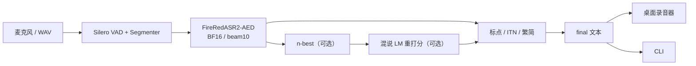

# FireRedASR2S

> 版本：v3.3
> 精度优先的粤语 / 普通话 / 英文句级语音转写系统，附桌面录音器与 Docker 后端。

---

## 1. 当前状态

| 模块 | 状态 |
| --- | --- |
| 后端推理 | 官方 FireRedASR2-AED PyTorch，BF16，beam10；CPU 保留 sherpa ONNX 路径 |
| 句级切分 | Silero VAD + pre/post roll + 句段合并 |
| 后处理 | CT-Transformer 标点 + 保守 ITN + OpenCC 繁简 |
| 桌面录音器 | PyQt6；麦克风 → WebSocket → 逐句显示；assets 图标；自动滚底；同步写本地 CSV |
| 后端 Docker | GPU 镜像使用官方 AED + 本地模型/代码缓存；CPU 镜像保留 sherpa |
| 数据与评测 | 5 套验证集；严格英文 P/R/F1 + 混合 CER |
| 本地留存 | 录音器目录下 `transcripts/`；每场录音一个 CSV |
| 质量门禁 | `ruff` PASS；`pytest` 59 passed |

当前是 POC/内部验证阶段，不是生产成品；真实个人听写和会议数据尚未采集。

---

## 2. 场景与能力

### 支持

- 粤语（香港/广东）、普通话、英文，以及句内混说（code-switching）。
- 单句、句尾出字；不做逐字 `partial`。
- 个人语言输入：单人、近场、句尾文本。
- 会议全文转写：多人、远场、只出全文，不区分说话人。
- 桌面录音器、WAV CLI、WebSocket 后端、GPU Docker。
- 录音器每条 `final` 立即写入录音器目录下的 `transcripts/`；每场一个 CSV；关闭窗口不丢内容。

### 不做

- 不做说话人分离（diarization）。
- 不做会议摘要/待办。
- 不做 LLM rerank、模型微调。
- 热词等业务词表确定后再接入。

---

## 3. 架构



- 后端：`FastAPI + uvicorn`，`/ws` WebSocket，`/health` 健康检查。
- 前端：`PyQt6 + QtMultimedia`，16kHz/16bit/mono PCM，20ms 一帧。
- 前后端通过 `ws://<后端IP>:8000/ws` 解耦。

---

## 4. 快速开始

### 4.1 GPU Docker（推荐）

要求：NVIDIA GPU、NVIDIA Container Toolkit、Docker Engine。

```bash
# 首次准备本地模型/上游代码缓存
bash scripts/setup_official_aed.sh

# 使用本地 models/ 构建，不下载模型
bash scripts/build_docker_gpu_local.sh

# 启动
docker run -d --gpus all \
  --name firered-asr-gpu \
  -p 8000:8000 \
  --restart unless-stopped \
  firered-asr:gpu
```

健康检查：

```bash
curl http://127.0.0.1:8000/health
```

默认配置 `configs/app_docker.yaml`：

- 官方 AED、BF16、beam10、1-best
- 不套 MCE LM
- 模型/代码来自本地 `models/` 缓存
- 基础镜像默认 `pytorch/pytorch:2.10.0-cuda12.8-cudnn9-runtime`，可用 `BASE_IMAGE` 覆盖

### 4.2 本机源码运行

CPU/sherpa 路径：

```bash
python3 -m pip install --user -r requirements.txt
./scripts/download_model.sh
PYTHONPATH=src python3 -m firered_poc.server --config configs/app.yaml
```

官方 AED 路径（需要 CUDA PyTorch 环境）：

```bash
python3 -m pip install --user -r requirements-aed.txt
bash scripts/setup_official_aed.sh
FIREREDASR2S_HOME=models/FireRedASR2S-code \
PYTHONPATH=src python3 -m firered_poc.server --config configs/app_official_1best.yaml
```

### 4.3 桌面录音器

源码运行：

```bash
python3 -m pip install --user -r requirements-recorder.txt
PYTHONPATH=src python3 -m firered_recorder
```

Windows exe：

1. 从 GitHub Actions `build-recorder` 下载 `FireRedRecorder-windows`。
2. 解压后运行 `FireRedRecorder.exe`。
3. 「后端」填 `ws://<后端IP>:8000/ws`，点「开始录音」。

未签名 exe 可能触发 SmartScreen。

### 4.4 WAV / CLI

```bash
PYTHONPATH=src python3 -m firered_poc.cli transcribe \
  --audio /path/to/audio.wav \
  --config configs/app.yaml --json
```

按句切分：

```bash
PYTHONPATH=src python3 -m firered_poc.cli transcribe \
  --audio /path/to/long.wav \
  --config configs/app.yaml --vad --json
```

录音器文件模式：

```bash
PYTHONPATH=src python3 -m firered_recorder \
  --url ws://127.0.0.1:8000/ws \
  --file eval/yue_en/audio/yue_en_004.wav \
  --no-realtime
```

---

## 5. 配置

| 文件 | 用途 |
| --- | --- |
| `configs/app.yaml` | CPU / sherpa ONNX |
| `configs/app_official_1best.yaml` | 官方 AED，BF16，beam10，无 LM |
| `configs/app_official.yaml` | 官方 AED + MCE n-best LM（仅 MCE 回归） |
| `configs/app_docker.yaml` | GPU Docker：官方 AED，无 LM |
| `requirements.txt` | 后端 CPU 依赖 |
| `requirements-aed.txt` | 官方 AED 额外依赖 |
| `requirements-recorder.txt` | 录音器依赖 |

常用配置：

```yaml
vad:
  backend: silero
  max_end_silence_ms: 450
  merge_gap_ms: 1200

asr:
  backend: firered_aed_torch
  use_gpu: true
  use_half: true
  beam_size: 10
  nbest: 1

postprocess:
  punctuation: true
  itn: true
  output_script: simplified
```

---

## 6. 验证集与结果

| 子集 | 数量 | 性质 | 授权 |
| --- | ---: | --- | --- |
| `eval/yue/` | 20 | 纯粤语词典朗读 | CC BY 4.0 |
| `eval/en/` | 20 | LibriSpeech 英文 | CC BY 4.0 |
| `eval/yue_en/` | 100 | MCE 半自發混说 | 仅研究 |
| `eval/yue_en_spont/` | 153 | WSYue 自發混说 | CC BY-NC 4.0 |
| `eval/yue_en_dictation/` | 100 | SwitchLingua 听写代理 | CC BY-NC 4.0 |

当前指标：

| 数据 | 官方 AED 1-best | 官方 AED + LM |
| --- | ---: | ---: |
| MCE 100 | 87.4% F1 / 6.5% CER | **88.4% / 6.0%** |
| WSYue 自發 153 | **71.5% / 10.1%** | 70.5% / 10.2% |
| SwitchLingua 听写代理 100 | **88.5% / 6.6%** | 83.2% / 9.4% |

- 纯粤语 CER：**4.7%**
- 纯英文 WER：**0.9%**
- 指标：英文词 P/R/F1、混合 CER（中文按字、英文按词）。
- MCE LM 只在 MCE 域有效；对自發/听写代理会退化，默认不启用。

运行：

```bash
PYTHONPATH=src python3 scripts/eval_suite.py \
  --config configs/app_official_1best.yaml \
  --sets yue,en,yue_en,yue_en_spont,yue_en_dictation \
  --output eval/baseline_current.json
```

---

## 7. 目录

```text
FireRedASR2S/
├── assets/                     # 录音器图标
├── configs/                    # CPU / 官方 AED / LM / Docker 配置
├── docs/                       # 架构、POC、录音器、Docker、数据、文档索引
├── eval/                       # 粤语 / 英文 / MCE / WSYue / SwitchLingua
├── scripts/                    # 模型准备、评测、数据校验、录音器/Docker 构建
├── src/firered_poc/            # 后端：VAD、切分、ASR、后处理、WS
├── src/firered_recorder/       # 桌面录音器（含 CSV 持久化）
├── tests/                      # unit / integration / gui
├── Dockerfile                  # CPU 镜像（下载模型）
├── Dockerfile.local            # CPU 镜像（本地 sherpa 模型）
├── Dockerfile.gpu              # GPU 镜像（官方 AED + 本地缓存）
├── requirements.txt
├── requirements-aed.txt
├── requirements-recorder.txt
└── pyproject.toml
```

---

## 8. 文档

- [`docs/README.md`](docs/README.md)：文档索引与阅读顺序。
- [`docs/ARCHITECTURE.md`](docs/ARCHITECTURE.md)：正式方案、参数与质量目标。
- [`docs/POC.md`](docs/POC.md)：POC 范围、接口、配置与运行方式。
- [`docs/RECORDER.md`](docs/RECORDER.md)：录音器协议、跨机器部署、Windows 打包。
- [`docs/DOCKER.md`](docs/DOCKER.md)：CPU/GPU 镜像、本地模型、端口与运行。
- [`docs/DATA.md`](docs/DATA.md)：个人听写/会议数据采集、标注、划分与校验。

---

## 9. 限制与后续

- 句级非流式，文字按句出现；不做 `partial`。
- 会议全文不做说话人区分、摘要或待办。
- 真实个人听写和会议数据尚未采集。
- 热词按业务词表后接入；LLM/微调当前不做。
- GPU Docker 镜像包含 4.7GB 官方权重，体积较大；可换更瘦的 CUDA 基础镜像。
- 跨公网需 WSS、反向代理与鉴权；当前面向可信局域网。
