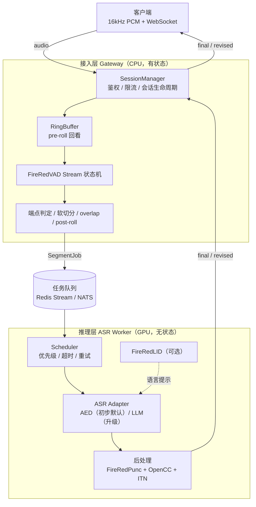
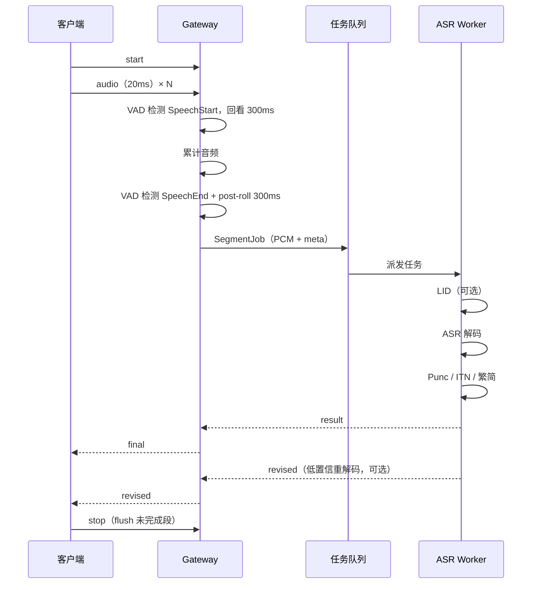
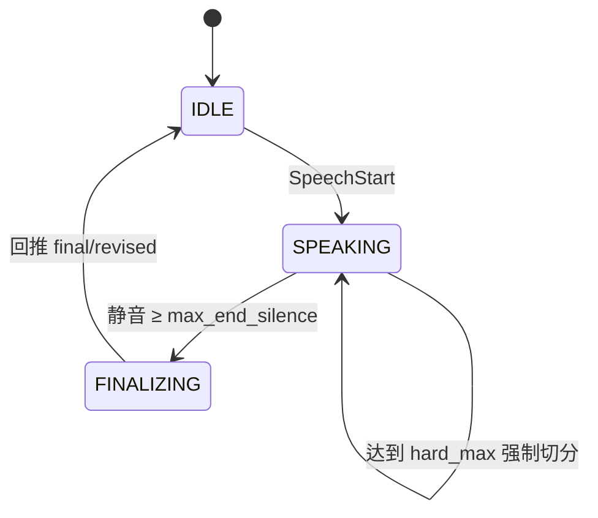
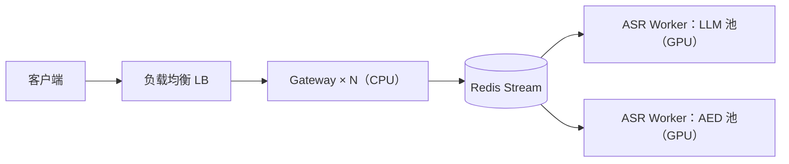
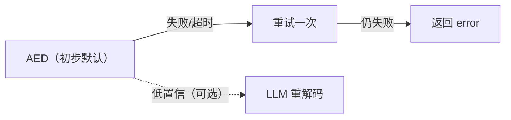

# FireRedASR2S 三语准实时语音识别系统 — 完整技术方案

> 版本：v1.3
> 定位：**粤语 + 普通话 + 英文 + 句内混说**（code-switching，句内语码混用），**精度优先**（Accuracy First），句级出字。
> 阶段策略：**初步设计以 FireRedASR2-AED 为默认后端（均衡/高并发）**，LLM 作为精度升级与低置信重解码路径；**只维护 FireRedASR2 一套引擎，不做跨引擎降级**。

---

## 1. 方案摘要

| 项 | 结论 |
| --- | --- |
| 识别范式 | **流式 VAD（Voice Activity Detection，语音活动检测）切分 + 句级非流式大模型整句推理**（不做逐字流式） |
| 默认模型（初步） | **FireRedASR2-AED（Attention-based Encoder-Decoder，注意力编码器-解码器，1B+，BF16）**，均衡/高并发 |
| 精度升级 | FireRedASR2-LLM（Large Language Model，大语言模型，8B+，BF16）；低置信重解码 / `accuracy` 模式 |
| 失败策略 | 重试一次 → 明确 `error`；不维护第二套引擎 |
| 默认模式 | `balanced`（初步）；`accuracy` 在接入 LLM 后启用 |
| VAD | FireRedVAD（Stream 模式，CPU） |
| 语种识别 | FireRedLID（Language Identification，语种识别；可选，句级标签 + 语言提示） |
| 标点/规整 | FireRedPunc + OpenCC（繁简转换工具） + 规则 ITN（Inverse Text Normalization，逆文本规整） |
| 接入协议 | WebSocket，16kHz/16bit/单声道 PCM（Pulse Code Modulation，脉冲编码调制），20ms 帧 |
| 精度模式延迟 | 端到端 **~0.8~1.2s**（p95，95 分位 ≤ 1.2s） |
| 均衡模式延迟 | 端到端 **~0.6~0.8s**（p95 ≤ 0.8s；初步默认） |
| 服务端语言 | Python（贴合 FireRedASR2S 官方推理代码） |
| 部署形态 | 有状态接入层（CPU）+ 无状态推理层（GPU），水平扩展 |

一句话：**用 0.5~0.6s 的静音等待，换取完整句上下文与非流式大模型的满血精度。** 初步用 AED 保证吞吐与落地速度，再以 LLM 重解码补齐精度上限。

### 1.1 已锁定决策

1. **分阶段精度优先**：初步默认 AED（均衡/高并发），LLM 作为精度升级与低置信重解码；不做 INT8 量化，不为了延迟牺牲上下文。
2. **统一多语模型**：不做"先判语种再选模型"的硬路由，由 FireRedASR2 单模型处理粤/普/英及混说。
3. **句级而非逐字**：允许说完停顿后再出整句；`partial` 草稿仅作可选体验。
4. **前后填充 + 少切分**：pre-roll（句首回看）300ms、post-roll（句尾保留）300ms；精度模式静音 550ms / overlap（切分段重叠）600ms，均衡模式（初步默认）450ms / 400ms。
5. **Adapter（适配器）可插拔**：AED（初步默认）/ LLM（精度升级）同一接口，支持双跑对比。
6. **两遍可选**：AED 快速初稿 + 低置信句 LLM 重解码（`revised` 回推）。

---

## 2. 需求与验收

### 2.1 功能需求

| 编号 | 需求 |
| --- | --- |
| F1 | 实时接收客户端推流（16k/16bit/mono PCM，20/40ms 帧） |
| F2 | 流式 VAD 检测语音起止，句级切分，支持长句软/硬切分 |
| F3 | 粤语、普通话、英文识别，支持句内中英/粤英混说 |
| F4 | 输出整句文本，含标点、ITN 规整、繁简归一 |
| F5 | 返回句级时间戳（start_ms/end_ms）与语言标签 |
| F6 | 支持 `accuracy` / `balanced` 两种模式 |
| F7 | 可选返回低置信重解码的 `revised` 结果 |
| F8 | 多路并发、会话隔离、异常兜底与失败重试 |

### 2.2 非功能需求（初版目标，内部测试集校准后锁定）

| 指标 | 目标 |
| --- | --- |
| 普通话 CER（Character Error Rate，字符错误率） | ≤ 3.0% |
| 粤语平均 CER | ≤ 12.0% |
| 英文 WER（Word Error Rate，词错误率） | ≤ 5.0% |
| 中英/粤英混说 CER | ≤ 10.0% |
| 静音/噪声幻觉率 | ≤ 0.5%（输出非空且与音频无关的比例） |
| 端到端延迟（accuracy，p95） | ≤ 1.2s |
| 端到端延迟（balanced，p95） | ≤ 0.8s |
| 可用性 | 99.9% |
| 会话隔离 | 单路异常不影响其他会话 |

### 2.3 明确不做

- 不做逐字真流式（不用流式 ASR 模型）。
- 不做说话人分离 / 声纹识别。
- 不做离线批量转写（架构可复用，但不在本期）。
- 不为延迟做 INT8 量化（与精度优先冲突）。
- **不维护第二套 ASR 引擎**（不引入 FunASR 等跨引擎降级）。

---

## 3. 系统架构

### 3.1 逻辑架构



### 3.2 组件职责

| 组件 | 职责 | 部署 |
| --- | --- | --- |
| Gateway | WS 连接、会话生命周期、音频缓冲、VAD 切分、结果回推 | CPU，多实例 |
| SessionManager | 每路会话状态机、超时清理、配额 | 随 Gateway |
| SegmentBuilder | RingBuffer、pre/post roll、soft/hard 切分、overlap | 随 Gateway |
| Job Queue | 解耦接入与推理，削峰、重试、死信 | Redis/NATS |
| ASR Worker | 加载模型、批处理、解码、后处理 | GPU，多实例 |
| Model Adapter | AED/LLM 统一接口 | 随 Worker |
| Postprocess | 标点、ITN、繁简、敏感/空结果处理 | 随 Worker |
| Evaluator | 离线评测三语 CER/WER、回归 | 独立 |

### 3.3 为什么这样分

- **接入层有状态、推理层无状态**：VAD 需要按会话维护缓冲，天然有状态；推理无状态才能自由扩缩容、灰度、双跑。
- **队列解耦**：GPU 抖动不会反压到 WS 连接；可做优先级与超时重试/拒绝。
- **VAD 放 CPU**：极轻量，避免占用 GPU 显存与调度。

---

## 4. 模型与组件选型

### 4.1 初步组合（AED 默认，均衡/高并发）

| 模块 | 选型 | 关键参数 | 说明 |
| --- | --- | --- | --- |
| VAD | FireRedVAD Stream | 0.6M 参数 | 100+ 语言，speech/singing/music，强抗噪 |
| ASR（初步默认） | **FireRedASR2-AED** | 1B+，BF16（16 位脑浮点） | 三语 + code-switch；均衡/高并发 |
| ASR（精度升级） | FireRedASR2-LLM | 8B+，BF16 | 低置信重解码 / `accuracy` 模式；Prompt（提示词）注入 |
| LID | FireRedLID（可选） | 100+ 语言/20+ 方言 | 句级标签 + 语言提示 |
| Punc | FireRedPunc | 中英 | 与 ASR 同体系 |
| 归一 | OpenCC + 规则 ITN | - | 繁简、数字/日期/金额 |

> 初步设计**不默认部署 LLM**；Adapter 预留接口，待 AED 基线稳定、评测集就绪后再按需接入。

### 4.2 精度对照（官方公开评测，CER 越低越好）

| 场景 | FireRedASR2-LLM | FireRedASR2-AED |
| --- | --- | --- |
| 普通话（4 集平均） | **2.89%** | 3.05% |
| 方言（19 集平均） | **11.55%** | 11.67% |
| 粤语 ws-yue-short / long | 5.14% / 8.71% | 5.15% / 8.54% |
| 粤语 md-yue-daily / conv | **3.61%** / 12.23% | 3.35% / **11.66%** |
| 英文 | 支持 | 支持 |

> AED 在粤语对话集上已具竞争力，且吞吐/显存更友好，故作为初步默认；LLM 作为精度升级路径，上线前按内部集双跑决定是否切换默认。

### 4.3 失败策略（单引擎）

- 只维护 FireRedASR2 一套引擎（AED 默认、LLM 可选升级），不引入 FunASR 等第二套 ASR。
- 推理失败或超时：**原任务重试一次**；仍失败则返回明确 `error`，不返回不可信文本。
- 队列积压：背压拒绝新任务并返回可观测错误码，不跨引擎降级。
- 降低成本：通过重试、超时、扩容解决，不用"换小模型"掩盖故障。

---

## 5. 端到端流程

### 5.1 时序



### 5.2 会话状态机



### 5.3 切分规则

1. **前置回看**：SpeechStart 时刻向前回看 300ms（ring buffer 常驻 400ms）。
2. **尾点判定**：静音持续 550ms（accuracy）/ 450ms（balanced）触发 SpeechEnd。
3. **尾部填充**：额外保留 300ms（accuracy）/ 150ms（balanced）。
4. **软切分**：单段达 20s，在最近能量低谷处切，保留 600ms overlap。
5. **硬切分**：单段达 30s，强制切，保留 600ms overlap。
6. **最短语音**：< 250ms 丢弃，抑制噪声误触发。

---

## 6. 精度优化设计

| 手段 | 做法 | 预期收益 |
| --- | --- | --- |
| 大模型（升级） | LLM 8B+，BF16，用于低置信重解码 / `accuracy` 模式；初步默认 AED | 长尾与复杂语境改善 |
| Prompt 注入 | 领域、专名、期望语言写入 system/user prompt | 专名与语种混淆改善 |
| 热词偏置 | AED 热词表加权；LLM Prompt 列举 | 品牌/人名/缩写召回 |
| LID 提示 | FireRedLID 标签作为语言提示 | 降低语种误判 |
| 前后填充 | pre 300ms / post 300ms | 防吞首字、截尾辅音 |
| 长上下文 | 软 20s / 硬 30s，overlap 600ms | 减少断句丢语义 |
| 大 beam（束搜索宽度） | beam=5 | 解码更稳 |
| 两遍重解码 | 低置信 AED → LLM 重解 | 长尾错误修正 |
| 不做量化 | BF16/FP16 | 避免精度损失 |

**幻觉抑制**：FireRedVAD 过滤非人声；最短语音门限；输出长度/字符集合理性校验；空音频强制返回空。

---

## 7. 接口协议

### 7.1 客户端 → 服务端

| 类型 | 载荷 |
| --- | --- |
| `start` | `{"type":"start","sample_rate":16000,"format":"pcm_s16le","lang":"auto","mode":"accuracy","output_script":"simplified","request_id":"..."}` |
| `audio` | 二进制 PCM 帧（20ms=640B） |
| `stop` | `{"type":"stop"}` 触发 flush |

### 7.2 服务端 → 客户端

| 类型 | 载荷 |
| --- | --- |
| `ready` | `{"type":"ready","session_id":"..."}` |
| `partial`（可选） | `{"type":"partial","segment_id":1,"text":"..."}` |
| `final` | `{"type":"final","segment_id":1,"text":"...","lang":"yue","confidence":0.93,"start_ms":0,"end_ms":3200}` |
| `revised`（可选） | 同 `final`，针对低置信重解码 |
| `error` | `{"type":"error","code":"...","message":"..."}` |

字段约定：`lang ∈ {auto,zh,yue,en}`；`mode ∈ {accuracy,balanced}`；`output_script ∈ {simplified,traditional,as-is}`；`segment_id` 会话内单调递增。

### 7.3 可靠性约定

- 每条 `final` 带 `request_id` + `segment_id`，客户端可幂等去重。
- 服务端对同一 `segment_id` 至多一次 `final`、一次 `revised`。
- `error` 后会话保持可继续（除非鉴权/协议错误）。

---

## 8. 服务设计

### 8.1 代码结构（建议）

```text
FireRedASR2S/
├── docs/ARCHITECTURE.md
├── configs/
│   ├── app.yaml
│   └── model.yaml
├── src/
│   ├── gateway/
│   │   ├── server.py          # WS 接入
│   │   ├── session.py         # 会话状态机
│   │   └── segment.py         # RingBuffer/切分
│   ├── vad/
│   │   └── firered_vad.py     # Stream VAD 封装
│   ├── asr/
│   │   ├── base.py            # ASRAdapter 接口
│   │   ├── firered_llm.py
│   │   ├── firered_aed.py
│   │   └── funasr_adapter.py
│   ├── postprocess/
│   │   ├── punc.py
│   │   ├── itn.py
│   │   └── script.py          # OpenCC 繁简
│   ├── scheduler/
│   │   ├── queue.py
│   │   └── worker.py
│   └── common/
│       ├── config.py
│       └── metrics.py
├── tests/
│   ├── unit/
│   ├── integration/
│   └── eval/                  # 三语评测集
└── pyproject.toml
```

### 8.2 核心接口

```python
class ASRAdapter(Protocol):
    def transcribe(
        self,
        pcm: bytes,
        sample_rate: int = 16000,
        lang: str = "auto",
        prompt: str | None = None,
        beam_size: int = 5,
    ) -> ASRResult: ...

@dataclass
class ASRResult:
    text: str
    lang: str | None
    confidence: float | None
    start_ms: int
    end_ms: int
```

Adapter 约定：输入为单句完整 PCM；输出已含原始文本；后处理（标点/ITN/繁简）在 Worker 统一执行，保证多后端一致。

### 8.3 并发模型

- Gateway：asyncio 单进程多连接，VAD 计算放线程池，避免阻塞事件循环。
- Queue：Redis Stream / NATS，按会话分区，保证同会话有序。
- Worker：每 GPU 进程一个模型实例；`accuracy` 模式小批窗口（0~10ms），`balanced` 模式 10~20ms。
- 超时：Job 级 deadline（accuracy 1.2s / balanced 0.8s），超时按重试/失败策略处理。

---

## 9. 部署架构



- **模型分发**：权重从 ModelScope / HuggingFace 预下载到镜像或共享存储。
- **进程隔离**：LLM 与 AED 可分别部署为独立 Worker 池，按 `mode` 路由。
- **灰度**：按 `request_id` 灰度新模型/新 Prompt，便于 A/B。
- **扩缩容**：Gateway 按连接数；Worker 按队列深度与 GPU 利用率。

### 9.1 容量参考

| 后端 | 显存 | 单卡并发（实时流） | 备注 |
| --- | --- | --- | --- |
| FireRedASR2-AED | 1.5~3GB | 30~60（24GB） | 动态批处理；**初步默认** |
| FireRedASR2-LLM | 16GB+ 权重 | 约 4~10（24GB，视卡/vLLM） | 精度升级；建议 A100/H20 提升并发 |

> 初步落地：AED 池跑在 24GB 卡；LLM 池按精度升级需求再上 A100 80G / H20。

---

## 10. 可靠性与失败处理

### 10.1 失败处理（单引擎）



- 触发条件：模型异常、队列超时、显存不足、单句超长。
- 不维护第二套引擎：失败只重试，不切换到 FunASR 等外部模型。
- LLM 是**精度升级/重解码路径**，不是降级项；初步可不部署。
- 失败与重试在响应/监控中可观测，不静默吞错。

### 10.2 异常处理

| 场景 | 处理 |
| --- | --- |
| 音频过短/空 | 直接返回空文本，不入模型 |
| VAD 误触发 | 最短语音 + 能量门限过滤 |
| 单句超长 | 软/硬切分 + overlap |
| 推理超时 | 重试一次；仍失败返回 error |
| 队列积压 | 背压拒绝新任务，返回可观测错误码 |
| 客户端断连 | 清理会话与缓冲，取消未完成任务 |

---

## 11. 可观测性与评测

### 11.1 指标

- 延迟：VAD 端点耗时、排队耗时、推理耗时、端到端 p50/p95/p99。
- 质量：分语种 CER/WER、混说 CER、幻觉率、空结果率、失败率/重试率。
- 资源：GPU 利用率/显存、队列深度、活跃会话数。
- 业务：每会话句数、平均句长、`revised` 触发率。

### 11.2 评测集

| 集合 | 内容 | 用途 |
| --- | --- | --- |
| zh-clean | 普通话朗读/对话 | 基线 CER |
| yue-hk | 香港粤语（含港式英文） | 粤语 CER |
| yue-gd | 广东粤语 | 口音覆盖 |
| en | 英文朗读/会议 | WER |
| mix | 中英/粤英混说 | 混说 CER |
| noise | 音乐/噪声/远场 | 幻觉率 |

### 11.3 回归门禁

- 每次模型/Prompt/切分参数变更，跑全量评测。
- 门禁：任一语种 CER 劣化 > 0.3pp 或幻觉率上升 > 0.1pp 则阻断发布。

---

## 12. 安全与合规

- 音频默认不落盘；如需留存，需显式开关与加密存储、定期清理。
- 日志脱敏：不记录原始音频与完整文本，仅记录哈希/长度/语言标签。
- 传输：WSS（WebSocket Secure）；鉴权：短期 token。
- 数据隔离：按租户/会话隔离，评测数据与生产数据分离。

---

## 13. 里程碑与交付物

| 阶段 | 交付物 | 完成标准 |
| --- | --- | --- |
| M1 骨架 | Gateway + Session + VAD + Mock ASR | 端到端跑通，延迟可测 |
| M2 真模型 | AED Adapter（初步默认）+ 三语验证 | 三语样本可识别，均衡模式延迟达标 |
| M3 精度增强 | 热词/LID/前后填充；LLM 两遍（可选） | 评测集 CER 达标 |
| M4 吞吐与压测 | 队列/批处理/重试/容量报告 | 目标并发稳定，p95 达标 |
| M5 上线 | 监控/灰度/回归门禁 | 灰度通过，SLO（Service Level Objective，服务等级目标）达成 |

---

## 14. 风险清单

| 风险 | 影响 | 缓解 |
| --- | --- | --- |
| LLM 显存/延迟压力 | 并发低、成本高 | AED 池分流；低置信才走 LLM；A100/H20 |
| 粤语对话集 AED 略优 | 选型不确定 | 双跑评测后按场景择优 |
| 混说样本不足 | 混说精度不达标 | 自建混说评测集 + Prompt 提示 |
| 繁简不一致 | 体验/下游不一致 | OpenCC 统一 + `output_script` |
| 端点切分吞字/截尾 | 首尾字错误 | pre/post roll + overlap + 调参 |
| 背景音乐误判 | 幻觉 | FireRedVAD + 最短语音 + 合理性校验 |
| 队列积压 | 延迟抖动 | 背压 + 重试 + 扩容 |

---

## 15. 附录

### 15.1 配置示例（`configs/app.yaml`）

```yaml
audio:
  sample_rate: 16000
  frame_ms: 20

vad:
  backend: firered_vad_stream
  pre_roll_ms: 300
  post_roll_ms: 300
  ring_buffer_ms: 400
  max_end_silence_ms: 450      # accuracy: 550
  min_speech_ms: 250
  soft_max_segment_ms: 12000   # accuracy: 20000
  hard_max_segment_ms: 15000   # accuracy: 30000
  segment_overlap_ms: 400      # accuracy: 600

asr:
  mode: balanced               # balanced（初步默认） | accuracy
  balanced:
    backend: firered_asr2_aed
    precision: bf16
    beam_size: 3
  accuracy:                    # 接入 LLM 后启用
    backend: firered_asr2_llm
    precision: bf16
    beam_size: 5
    prompt: "领域: ...; 语言: 粤语/普通话/英文可混说"

postprocess:
  punc: firered_punc
  itn: true
  output_script: simplified    # simplified | traditional | as-is

scheduler:
  queue: redis_stream
  job_deadline_ms: 800         # accuracy: 1200
  max_retries: 1
```

### 15.2 术语

| 术语 | 含义 |
| --- | --- |
| Segment（句段） | 一段由 VAD 切出的完整句音频 |
| pre-roll / post-roll | 句首回看 / 句尾额外保留音频 |
| overlap | 切分段之间重叠，防断字 |
| LID | 语种识别 |
| ITN | 逆文本规整（数字/日期/金额） |
| 两遍 | AED 初稿 + LLM 重解码 |
| 精度模式 / 均衡模式 | LLM 优先 / AED 优先 |
