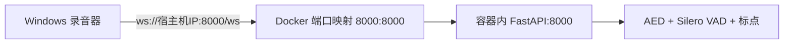

# FireRedASR2S 后端 Docker 镜像

> 版本：v1.4
> 目标：把后端依赖、配置和模型打包成镜像，服务器只需 `docker run` 即可提供 WebSocket API。
> 录音器仍在 Windows/本机独立运行，通过 `ws://<宿主机IP>:8000/ws` 连接。

---

## 1. 镜像内容

| 镜像 | 基础 | 推理 | 用途 |
| --- | --- | --- | --- |
| `firered-asr:latest` | `python:3.10-slim` | sherpa ONNX CPU | 轻量回归/无 GPU |
| `firered-asr:gpu` | `pytorch/pytorch:2.10.0-cuda12.8-cudnn9-runtime` | 官方 AED PyTorch BF16 | 精度优先/GPU 服务器 |

GPU 镜像使用本地缓存：

- 模型：`models/FireRedASR2-AED`（约 4.7GB 权重）
- 上游代码：`models/FireRedASR2S-code`
- Silero VAD、标点模型
- 构建时不下载模型；只拉基础镜像（可覆盖 `BASE_IMAGE`）

---

## 2. 架构



---

## 3. 构建

```bash
cd FireRedASR2S
docker build -t firered-asr:latest .
```

- 首次构建会下载 AED + Silero + 标点（约 1.2GB），耗时取决于网络。
### 3.1 使用本机模型构建（不下载）

本机已有 `models/`，直接烤进镜像：

```bash
bash scripts/build_docker_local.sh
```

等价的手工命令（需要 Docker BuildKit）：

```bash
docker build --build-arg SKIP_MODELS=1 -t firered-asr:base .
docker build --build-context models=./models -f Dockerfile.local -t firered-asr:latest .
```

- 脚本会检查 `models/` 里是否有 AED、Silero、标点；缺失会提示先下载。
- 不访问网络下载模型；本机模型原样复制进 `/app/models`。
- 镜像约 1.6GB（AED + Silero + 标点）。

### 3.2 GPU 后端（官方 AED，本地缓存）

```bash
bash scripts/build_docker_gpu_local.sh
docker run -d --gpus all --name firered-asr-gpu \
  -p 8000:8000 --restart unless-stopped \
  firered-asr:gpu
```

等价命令：

```bash
DOCKER_BUILDKIT=1 docker build \
  --build-context models=./models \
  -f Dockerfile.gpu \
  -t firered-asr:gpu .
```

- 默认配置 `configs/app_docker.yaml`：官方 AED、BF16、beam10、1-best。
- 不默认套 MCE LM：它在 WSYue/SwitchLingua 上会退化。
- 运行必须带 `--gpus all`；宿主机需 NVIDIA Container Toolkit。
- 前台协议不变，录音器仍填 `ws://<宿主机IP>:8000/ws`，无需改代码。

### 3.3 只挂载模型，不烤进镜像

```bash
docker build --build-arg SKIP_MODELS=1 -t firered-asr:local .
```

运行该镜像时把模型目录挂进去：

```bash
docker run -d --name firered-asr \
  -p 8000:8000 \
  -v "$(pwd)/models:/app/models:ro" \
  --restart unless-stopped \
  firered-asr:local
```

---

## 4. 运行

```bash
docker run -d \
  --name firered-asr \
  -p 8000:8000 \
  --restart unless-stopped \
  firered-asr:latest
```

查看启动信息：

```bash
docker logs -f firered-asr
```

应看到：

```text
==================================================================
 FireRedASR2S ASR backend
 ASR backend : firered_aed
 VAD backend : silero
 WebSocket endpoints:
   ws://172.17.0.2:8000/ws
==================================================================
```

> 容器内看到的 `172.x` 是容器 IP；Windows 录音器不要填这个，填 **宿主机 LAN IP**。

健康检查：

```bash
curl http://127.0.0.1:8000/health
docker inspect --format '{{.State.Health.Status}}' firered-asr
```

### 4.1 不需要 Docker Compose

单容器直接用 `docker run` 即可。等以后加入队列、缓存、多副本或 GPU Worker 池时，再考虑 compose / Kubernetes。

---

## 5. 录音器连接

Windows 录音器「后端」填：

```text
ws://<宿主机LAN-IP>:8000/ws
```

例如：

```text
ws://192.168.1.20:8000/ws
```

- 不要填容器 IP `172.17.x.x`。
- 不要填 `127.0.0.1`（除非录音器也在同一台机器）。
- 宿主机防火墙放行 8000/TCP。

---

## 6. 端口与配置

### 换宿主机端口

```bash
docker run -d --name firered-asr -p 8001:8000 --restart unless-stopped firered-asr:latest
```

录音器改成：

```text
ws://<宿主机IP>:8001/ws
```

### 修改配置

两种方式：

1. 重新构建镜像（配置已烤进镜像）。
2. 挂载配置目录：

```bash
docker run -d --name firered-asr \
  -p 8000:8000 \
  -v "$(pwd)/configs:/app/configs:ro" \
  firered-asr:latest
```

---

## 7. 资源与限制

| 项 | 说明 |
| --- | --- |
| CPU | CPU 镜像为 sherpa int8；GPU 镜像需 `--gpus all` |
| GPU | `firered-asr:gpu` 使用 PyTorch CUDA；显存约 3GB/实例 |
| 镜像体积 | CPU `SKIP_MODELS=1` 约 289MB；GPU 镜像含 4.7GB 官方权重，明显更大 |
| 并发 | 单进程 + 单模型；高并发需多副本/队列/GPU |
| 安全 | 无鉴权、无 TLS；仅建议可信局域网 |
| 更新模型 | 重新 `docker build`（加 `--no-cache` 可强制重下） |

---

## 8. 验证

```bash
# 1. 容器健康
curl http://127.0.0.1:8000/health

# 2. 宿主机文件模式（可选，需本机有 Python 与 recorder 依赖）
PYTHONPATH=src python3 -m firered_recorder \
  --url ws://127.0.0.1:8000/ws \
  --file models/sherpa-onnx-fire-red-asr2-zh_en-int8-2026-02-26/test_wavs/0.wav \
  --no-realtime
```

期望返回 `final` 文本。

### 8.1 本机验证结果

| 项 | 结果 |
| --- | --- |
| `SKIP_MODELS=1` 镜像 | 289MB；挂载 `models/` 后健康检查 200 |
| 容器 + 录音器 E2E | 返回 2 条 `final`：`昨天是MONDAY。` / `TODAY IS礼拜二。THE DAY AFTER TOMORROW是星期三。` |
| 模型烤入镜像 | 本地验证镜像约 1.6GB（AED）；E2E 通过 |
| 说明 | 生产构建默认 `MODELS=aed`；模型下载步骤依赖网络，首次构建需等待 |

> 本机 8000 端口已被其他容器占用，验证时使用 `-p 8100:8000`；实际部署按宿主机端口调整。

---

## 9. 常见问题

| 现象 | 处理 |
| --- | --- |
| 构建卡在下载模型 | 网络慢；可先在本地 `./scripts/download_model.sh`，再用 `SKIP_MODELS=1` + 挂载 `models/` |
| 端口 8000 被占用 | 改 `-p 8001:8000`，录音器 URL 同步改 |
| 录音器连不上 | 确认用宿主机 LAN IP、防火墙放行、`curl http://IP:8000/health` 可达 |
| 容器健康检查失败 | `docker logs firered-asr`；首次加载模型可能需 20~30s |
