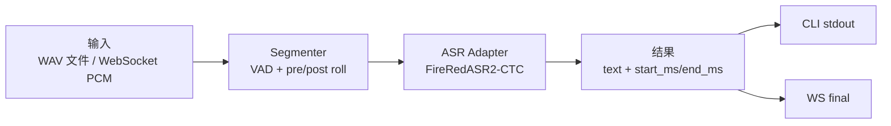
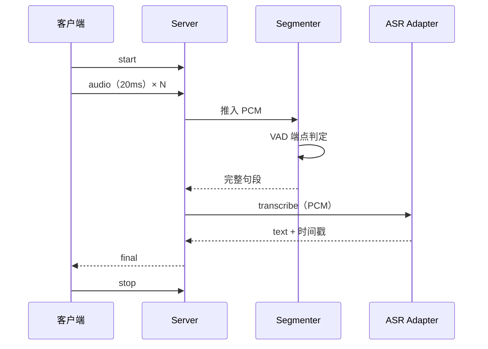

# FireRedASR2S POC 设计与 MVP 范围

> 版本：v1.1
> 目标：用最小闭环验证 **音频 → 句级文字**，并明确 MVP 要实现的功能、技术选型与验收标准。
> 状态：**POC MVP 已实现并跑通**（WAV + WebSocket，真实 FireRedASR2-CTC）。

---

## 1. POC 目标

POC（Proof of Concept，概念验证）只回答一个问题：**用 FireRedASR2 能否把粤语、普通话、英文及混说的整句音频稳定转成文字。**

验证范围：

1. **WAV 文件转写**：一条命令输入音频，输出整句文本。
2. **WebSocket 流式转写**：客户端推 PCM，句尾返回整句文本。
3. **真实模型**：使用 FireRedASR2 权重，不用 Mock。
4. **三语覆盖**：粤语（香港/广东）、普通话、英文，含句内混说（code-switching，语码混用）。

---

## 2. MVP 功能清单

| 编号 | 功能 | 说明 |
| --- | --- | --- |
| F1 | WAV 文件转写 | 读 16kHz/16bit/mono；非 16kHz 自动重采样 |
| F2 | WebSocket 串流 | 接收 20ms PCM（Pulse Code Modulation，脉冲编码调制）帧，句尾回 `final` |
| F3 | 句级切分 | pre-roll（句首回看）300ms、post-roll（句尾保留）300ms、静音 450ms、最短 250ms、最长 15s |
| F4 | 非流式 ASR（Automatic Speech Recognition，自动语音识别） | 整句送入 FireRedASR2，返回 `text` 与 `start_ms/end_ms` |
| F5 | 单引擎失败处理 | 重试一次；仍失败返回明确 `error`，不跨引擎降级 |
| F6 | 配置化 | 模型路径、VAD（Voice Activity Detection，语音活动检测）参数、线程数走 YAML |
| F7 | CLI + WS 服务 | 一条命令转档；一个 WS 端点；`/health` 健康检查 |
| F8 | 基础测试 | 切分器、VAD、会话状态机的单元测试 |

---

## 3. 非目标（POC 不做）

- 不接 FireRedASR2-LLM（8B+）与低置信重解码。
- 不做标点恢复、ITN（Inverse Text Normalization，逆文本规整）、繁简归一。
- 不做 LID（Language Identification，语种识别）与 Prompt/热词注入。
- 不做动态批处理、多卡、队列削峰、生产级监控。
- 不用 FireRedVAD；POC 用轻量 VAD 代替。
- 不做说话人分离、离线批量转写。

---

## 4. 技术选型

### 4.1 推荐路径：sherpa-onnx + FireRedASR2-CTC

| 项 | 选择 | 理由 |
| --- | --- | --- |
| 推理运行时 | sherpa-onnx | 纯 ONNX（Open Neural Network Exchange，开放神经网络交换格式）、CPU 可跑、安装简单 |
| 模型 | FireRedASR2-CTC-int8（约 520MB） | 仍是 FireRedASR2 权重，支持粤/普/英与混说；CTC（Connectionist Temporal Classification，连接时序分类）在 CPU 上快 |
| 备选模型 | FireRedASR2-AED ONNX（约 838MB） | 与正式默认 AED（Attention-based Encoder-Decoder，注意力编码器-解码器）一致，但更慢 |
| 正式生产 | 官方 FireRedASR2S PyTorch + AED/LLM + CUDA | POC 只验证可行性，不替代生产方案 |

> 选择 CTC 是 POC 的工程取舍：同一模型家族、无需 CUDA、能最快跑通"音频到文字"。Adapter（适配器）隔离后端，后续换 AED/LLM 不动上层。

### 4.2 关键指标参考

- 官方文档中 CTC 单句 RTF（Real Time Factor，实时率）约 0.17，AED 约 0.33（CPU）。
- POC 目标：10s 音频单句延迟可接受、WS 端到端 < 2s；不承诺生产延迟。

---

## 5. 系统架构



WebSocket 时序：



---

## 6. 模块与代码结构（待实现）

```text
src/firered_poc/
├── audio.py          # WAV 读取 / 重采样
├── vad.py            # 能量 VAD（可换 Silero）
├── segmenter.py      # RingBuffer / 端点 / 软硬切分
├── asr/
│   ├── base.py       # ASRAdapter 接口
│   └── sherpa.py     # FireRedASR2 CTC/AED 实现
├── session.py        # 会话状态机
├── server.py         # WebSocket 服务
└── cli.py            # 文件转写命令
configs/app.yaml
tests/unit/
```

核心接口：

```python
class ASRAdapter(Protocol):
    def transcribe(self, pcm: bytes, sample_rate: int = 16000) -> ASRResult: ...

@dataclass
class ASRResult:
    text: str
    start_ms: int
    end_ms: int
```

---

## 7. 接口协议

**客户端 → 服务端**

| 类型 | 载荷 |
| --- | --- |
| `start` | `{"type":"start","sample_rate":16000,"format":"pcm_s16le"}` |
| `audio` | 二进制 PCM（20ms = 640B） |
| `stop` | `{"type":"stop"}` |

**服务端 → 客户端**

| 类型 | 载荷 |
| --- | --- |
| `ready` | `{"type":"ready","session_id":"..."}` |
| `final` | `{"type":"final","segment_id":1,"text":"...","start_ms":0,"end_ms":3200}` |
| `error` | `{"type":"error","code":"ASR_FAILED","message":"..."}` |

CLI：

```bash
python -m firered_poc.cli transcribe --audio test.wav
```

---

## 8. 配置示例

```yaml
server:
  host: 0.0.0.0
  port: 8000

audio:
  sample_rate: 16000
  frame_ms: 20

vad:
  backend: energy            # energy | silero
  energy_threshold: 0.02
  pre_roll_ms: 300
  post_roll_ms: 300
  max_end_silence_ms: 450
  min_speech_ms: 250
  hard_max_segment_ms: 15000

asr:
  backend: firered_ctc       # firered_ctc | firered_aed
  model: models/sherpa-onnx-fire-red-asr2-ctc-zh_en-int8-2026-02-25/model.int8.onnx
  tokens: models/sherpa-onnx-fire-red-asr2-ctc-zh_en-int8-2026-02-25/tokens.txt
  num_threads: 2
  provider: cpu
```

---

## 9. 验收标准

1. **真实转写**：用模型自带 `test_wavs` 的中文、粤语、英文样例，实际输出非空且与参考文本接近。
2. **端到端**：WAV CLI 与 WS 两条链路都能返回 `final` 文本。
3. **延迟记录**：记录 10s 音频的单句推理耗时与 WS 端到端耗时（POC 目标 < 2s）。
4. **质量门禁**：`ruff check .` 与 `pytest` 实际通过；报告存 `/tmp/opencode/reports/`，不入库。
5. **可复现**：README/POC 文档给出一条可复制的转写命令与输出样例。

### 9.1 实测结果（本地 CPU，2026-11-26）

| 样例 | 内容 | 结果 | 耗时 |
| --- | --- | --- | --- |
| `test_wavs/0.wav`（中英混说） | 整段 | `昨天是 MOAY TOAY IS礼拜八二 THE DAYAY AFTER TOMORROW是星期三` | 1.7~3.5s |
| `test_wavs/1.wav`（普通话） | 整段 | `这是第一种第二种叫呃与 ALWAYSISE ALWAYS什么意思啊` | 0.90s |
| `test_wavs/3-sichuan.wav`（四川话） | 整段 | `自己就是在那个在那个就是在情节里面就是感觉是演的特别好就是好像很真实一样你知道吧` | 1.33s |
| `yue.wav`（粤语） | 整段 | `呢几个字都表达唔到我想讲嘅意思` | 0.89s |
| `hello_en.wav`（英文） | 整段 | `HELLO SPEECH` | 0.41s |
| `test_wavs/0.wav`（WS 流式） | 5 段 | 5 条 `final`，句级时间戳正常 | 端到端约 2s |

> 质量门禁：`ruff check .` PASS；`pytest` 14 passed（含真实模型冒烟测试）。
> 结论：三语与混说均可出字；CTC 在英文与部分数字上仍有错字（如 `MONDAY TODAY`），属 POC 可接受范围。能量 VAD 会把自然停顿切成多段，后续可换 Silero VAD 或 FireRedVAD。

---

## 10. 里程碑

| 阶段 | 内容 | 预估 |
| --- | --- | --- |
| P0 | 安装 sherpa-onnx、下载模型、CLI 单档转写跑通 | 0.5 天 |
| P1 | Segmenter + WebSocket + 单元测试 | 1 天 |
| P2 | 演示样例、检查报告、进度同步 | 0.5 天 |

---

## 11. 风险与限制

| 风险 | 影响 | 缓解 |
| --- | --- | --- |
| CPU 推理慢 | 延迟高于生产 | POC 只验证可行性；生产换 GPU + AED/LLM |
| 无标点/ITN | 输出可读性一般 | POC 接受；P2 再接后处理 |
| 能量 VAD 对噪声不稳 | 切分不准 | 可切换 Silero VAD（+2MB 模型） |
| 模型下载 520MB | 首次启动慢 | 预下载到 `models/`，加入 `.gitignore` |
| 粤语/英语样例覆盖不全 | 三语验证不足 | 确认 `test_wavs` 覆盖，必要时补样例 |
| CTC 与正式 AED 有差异 | 精度结论不能直接外推 | 正式评测以 AED/LLM 为准 |

---

## 12. 默认决策

1. POC 后端：**sherpa-onnx FireRedASR2-CTC-int8**。
2. 入口顺序：**先 WAV CLI，再 WebSocket**。
3. VAD：**能量 VAD 起步**，预留 Silero 替换。
4. 失败策略：**单引擎重试一次 → error**，不引入 FunASR。

---

## 13. 运行方式（已验证）

安装依赖并下载模型：

```bash
python3 -m pip install --user -r requirements.txt
./scripts/download_model.sh
```

WAV 文件转写：

```bash
PYTHONPATH=src python3 -m firered_poc.cli transcribe \
  --audio models/sherpa-onnx-fire-red-asr2-ctc-zh_en-int8-2026-02-25/test_wavs/0.wav \
  --config configs/app.yaml --json
```

需要按句切分时加 `--vad`：

```bash
PYTHONPATH=src python3 -m firered_poc.cli transcribe \
  --audio /path/to/long.wav --config configs/app.yaml --vad --json
```

启动 WebSocket 服务：

```bash
PYTHONPATH=src python3 -m firered_poc.server --config configs/app.yaml
```

健康检查：`GET /health`；串流端点：`ws://127.0.0.1:8000/ws`。
发送 `start` → 二进制 20ms PCM → `stop`，接收 `final`。

质量门禁：

```bash
ruff check .
python3 -m pytest
```
