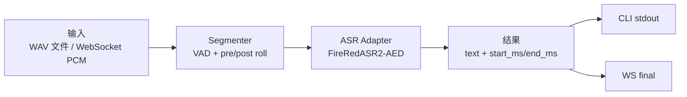
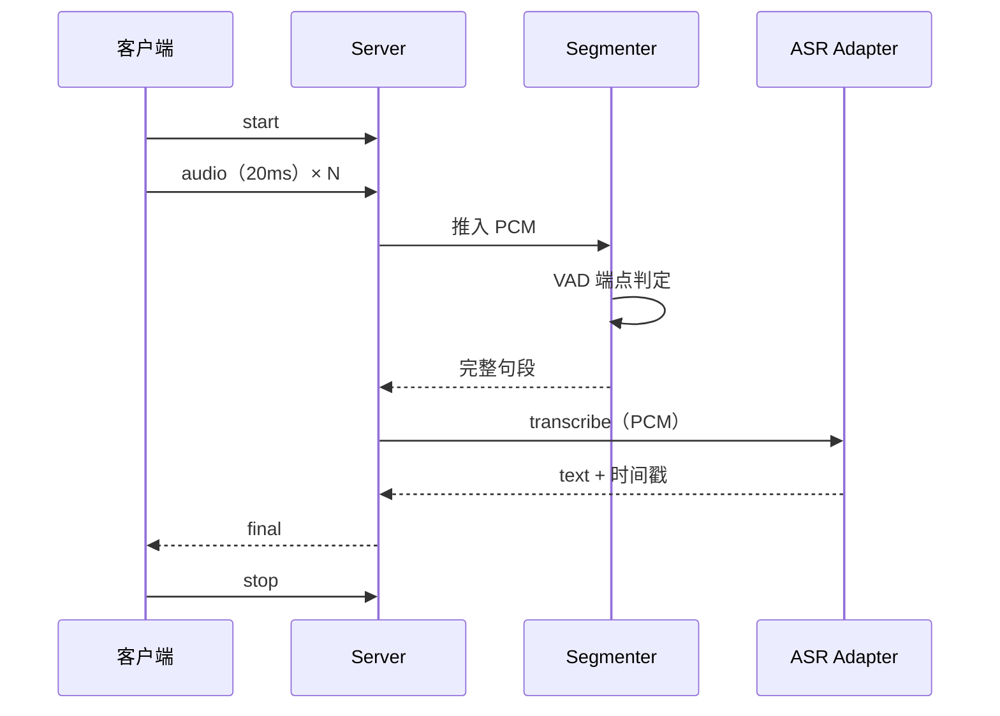

# FireRedASR2S POC 设计与 MVP 范围

> 版本：v2.4
> 目标：用最小闭环验证 **音频 → 句级文字**，并明确 MVP 要实现的功能、技术选型与验收标准。
> 状态：**POC MVP 已实现并跑通**（WAV + WebSocket，真实 FireRedASR2）；默认 AED；已接入 Silero VAD、句段合并、标点/ITN/繁简后处理。

---

## 1. POC 目标

POC（Proof of Concept，概念验证）只回答一个问题：**用 FireRedASR2 能否把粤语、普通话、英文及混说的整句音频稳定转成文字。**

验证范围：

1. **WAV 文件转写**：一条命令输入音频，输出整句文本。
2. **WebSocket 流式转写**：客户端推 PCM，句尾返回整句文本。
3. **真实模型**：使用 FireRedASR2 权重，不用 Mock。
4. **三语覆盖**：粤语（香港/广东）、普通话、英文，含句内混说（code-switching，语码混用）。

---

## 2. MVP 功能清单

| 编号 | 功能 | 说明 |
| --- | --- | --- |
| F1 | WAV 文件转写 | 读 16kHz/16bit/mono；非 16kHz 自动重采样 |
| F2 | WebSocket 串流 | 接收 20ms PCM（Pulse Code Modulation，脉冲编码调制）帧，句尾回 `final` |
| F3 | 句级切分 | pre-roll（句首回看）300ms、post-roll（句尾保留）300ms、静音 450ms、最短 250ms、最长 15s；支持相邻句段按 gap 合并 |
| F4 | 非流式 ASR（Automatic Speech Recognition，自动语音识别） | 整句送入 FireRedASR2，返回 `text` 与 `start_ms/end_ms`；含标点、ITN、繁简 |
| F5 | 单引擎失败处理 | 重试一次；仍失败返回明确 `error`，不跨引擎降级 |
| F6 | 配置化 | 模型路径、VAD（Voice Activity Detection，语音活动检测）参数、线程数走 YAML |
| F7 | CLI + WS 服务 | 一条命令转档；一个 WS 端点；`/health` 健康检查 |
| F8 | 基础测试 | 切分器、VAD、会话状态机、后处理与 WS 的测试 |

---

## 3. 非目标（POC 不做）

- 不接 FireRedASR2-LLM（8B+）与低置信重解码。
- 不做 LID（Language Identification，语种识别）与 Prompt/热词注入。
- 不做动态批处理、多卡、队列削峰、生产级监控。
- 不用 FireRedVAD；POC 用 Silero VAD 代替。
- 不做说话人分离、离线批量转写。

---

## 4. 技术选型

### 4.1 推荐路径：sherpa-onnx + FireRedASR2-AED

| 项 | 选择 | 理由 |
| --- | --- | --- |
| 推理运行时 | sherpa-onnx | 纯 ONNX（Open Neural Network Exchange，开放神经网络交换格式）、CPU 可跑、安装简单 |
| 默认模型 | **FireRedASR2-AED ONNX（约 838MB）** | 精度优先；中英/粤英混说表现最佳；与正式方案默认 AED 一致 |
| VAD | Silero VAD（约 0.6MB） | 比能量 VAD 稳，CPU 运行 |
| 句段合并 | `merge_gap_ms` | 减少自然停顿造成的碎句，文件模式默认开启 |
| 后处理 | CT-Transformer 标点 + cn2an ITN + OpenCC | 标点、日期/金额/百分比、繁简归一 |
| 正式生产 | 官方 FireRedASR2S PyTorch + AED/LLM + CUDA | POC 只验证可行性，不替代生产方案 |

> POC 只保留 AED；10s 音频 CPU 仍在 3s 内出字。Adapter（适配器）隔离后端，后续可替换为 LLM。

### 4.2 关键指标参考

- POC 实测 AED 约 0.25~0.33 RTF（Real Time Factor，实时率，CPU）。
- POC 目标：10s 音频单句延迟可接受；WS 端到端 AED 实测约 2.2s；不承诺生产延迟。

---

## 5. 系统架构



WebSocket 时序：



---

## 6. 模块与代码结构（已实现）

```text
src/firered_poc/
├── audio.py          # WAV 读取 / 重采样
├── vad.py            # Silero VAD / 能量 VAD
├── segmenter.py      # RingBuffer / 端点 / 软硬切分 / 句段合并
├── asr/
│   ├── base.py       # ASRAdapter 接口
│   └── sherpa.py     # FireRedASR2 AED 实现
├── postprocess.py    # 标点 / ITN / 繁简
├── session.py        # 会话状态机
├── server.py         # WebSocket 服务
└── cli.py            # 文件转写命令
configs/app.yaml
tests/unit/
tests/integration/
```

核心接口：

```python
class ASRAdapter(Protocol):
    def transcribe(self, pcm: bytes, sample_rate: int = 16000) -> ASRResult: ...

@dataclass
class ASRResult:
    text: str
    start_ms: int
    end_ms: int
```

---

## 7. 接口协议

**客户端 → 服务端**

| 类型 | 载荷 |
| --- | --- |
| `start` | `{"type":"start","sample_rate":16000,"format":"pcm_s16le"}` |
| `audio` | 二进制 PCM（20ms = 640B） |
| `stop` | `{"type":"stop"}` |

**服务端 → 客户端**

| 类型 | 载荷 |
| --- | --- |
| `ready` | `{"type":"ready","session_id":"..."}` |
| `final` | `{"type":"final","segment_id":1,"text":"...","start_ms":0,"end_ms":3200}` |
| `error` | `{"type":"error","code":"ASR_FAILED","message":"..."}` |

CLI：

```bash
python -m firered_poc.cli transcribe --audio test.wav
```

---

## 8. 配置示例

```yaml
server:
  host: 0.0.0.0
  port: 8000

audio:
  sample_rate: 16000
  frame_ms: 20

vad:
  backend: silero            # silero | energy
  energy_threshold: 0.02
  silero_model: models/silero_vad.onnx
  silero_threshold: 0.5
  silero_min_silence_ms: 500
  silero_min_speech_ms: 250
  silero_max_speech_ms: 20000
  silero_window_size: 512
  pre_roll_ms: 300
  post_roll_ms: 300
  max_end_silence_ms: 450
  min_speech_ms: 250
  hard_max_segment_ms: 15000
  merge_gap_ms: 1200        # 相邻句段间隔 ≤ 此值时合并（仅文件模式）

postprocess:
  punctuation: true
  punctuation_model: models/sherpa-onnx-punct-ct-transformer-zh-en-vocab272727-2024-04-12-int8/model.int8.onnx
  itn: true
  output_script: simplified  # as-is | simplified | traditional

asr:
  backend: firered_aed
  tokens: models/sherpa-onnx-fire-red-asr2-zh_en-int8-2026-02-26/tokens.txt
  encoder: models/sherpa-onnx-fire-red-asr2-zh_en-int8-2026-02-26/encoder.int8.onnx
  decoder: models/sherpa-onnx-fire-red-asr2-zh_en-int8-2026-02-26/decoder.int8.onnx
  num_threads: 2
  provider: cpu
```

---

## 9. 验收标准

1. **真实转写**：用模型自带 `test_wavs` 的中文、粤语、英文样例，实际输出非空且与参考文本接近。
2. **端到端**：WAV CLI 与 WS 两条链路都能返回 `final` 文本。
3. **延迟记录**：记录 10s 音频的单句推理耗时与 WS 端到端耗时（POC 目标 < 2s）。
4. **质量门禁**：`ruff check .` 与 `pytest` 实际通过；报告存本机临时目录，不入库。
5. **可复现**：README/POC 文档给出一条可复制的转写命令与输出样例。

### 9.1 实测结果（本地 CPU，2026-11-26）

| 样例 | 内容 | 结果 | 耗时 |
| --- | --- | --- | --- |
| `test_wavs/0.wav`（中英混说） | 整段 | `昨天是MONDAY TODAY IS礼拜二，THE DAY AFTER TOMORROW是星期三。` | 2.8s |
| `test_wavs/0.wav`（VAD + merge） | 1 段 | `昨天是MONDAY TODAY IS礼拜二，THE DAY AFTER TOMORROW是星期三。` | 2.8s |
| `test_wavs/1.wav`（普通话） | 整段 | `这是第一种。第二种叫呃与ALWAYS ALWAYS什么意思啊？` | 1.35s |
| `test_wavs/3-sichuan.wav`（四川话） | 整段 | `自己就是在那个在那个就是在情节里面，就是感觉戏演的特别好，就是好像很真实一样，你知道吧？` | 2.57s |
| `yue.wav`（粤语） | 整段 | `呢几个字都表达唔到我想讲嘅意思。` | 1.30s |
| `hello_en.wav`（英文） | 整段 | `HELLO SPEECH.` | 0.55s |
| `test_wavs/0.wav`（WS 流式） | 2 段 | 2 条 `final`：`昨天是MONDAY。` / `TODAY IS礼拜二。THE DAY AFTER TOMORROW是星期三。` | 2.24s |

> 质量门禁：`ruff check .` PASS；`pytest` 49 passed（含真实模型、Silero VAD、后处理与 WebSocket 冒烟测试）。
> 结论：AED 默认下三语与混说均可出字；Silero VAD + 句段合并减少碎句；标点/ITN/繁简显著提升可读性。

### 9.2 官方 AED PyTorch 对照（RTX 4090，BF16，beam=10）

| 引擎 | 粤语 CER | 英文 WER | 粤英英文词 F1 | 混合 CER |
| --- | --- | --- | --- | --- |
| sherpa int8 greedy | 11.5% | 1.1% | 84.3% | 7.2% |
| 官方 AED PyTorch | **4.7%** | **0.9%** | **87.4%**（P 88.7% / R 86.1%） | **6.5%** |
| 官方 AED + n-best LM | **4.7%** | **0.9%** | **88.4%**（P 90.1% / R 86.9%） | **6.0%** |

- 粤语 CER、英文 WER 在 100 条混说评测中保持不变；混说 F1 仍有提升。
- 原 20 条子集偏容易：官方 AED + LM 在该子集 F1 95.4%，扩到 100 条后为 88.4%；后续应以 100 条集为准。
- `beam=3` 对照：粤语 CER 7.5%、英文 WER 1.1%、混说 F1 90.3%、混合 CER 6.2%；最终 LM 配置使用 `beam=10`、`nbest=10`。
- 端到端（server + Silero VAD + 标点/ITN，beam10 + n-best LM）：8.78s 混说音频 **2.42s** 返回结果；GPU 整卡约 **3.7GB**（含其他进程约 0.9GB），服务进程约 **2.8GB**。
- 简单英文 OOV 纠错实验：只能修 `countstown→countdown`，F1 90.3% → 90.8%，收益有限；剩余错误多为合法英文词替换。
- 早期 n-best 上界实验（beam5、nbest5、按参考选最优）：混说 F1 **95.4%**、混合 CER **3.9%**，说明正确英文常在 n-best 中。
- 轻量重打分实验（confidence + 英文词频）反而退化：F1 88.6%~88.8%、混合 CER 6.9%，低于 1-best 的 90.3%/6.2%。说明仅靠词频不够。
- 改用 MCE train 文本训练小型混说 n-gram LM（排除评估 100 条），n-best 重打分后（beam10/nbest10，100 条）：混说 F1 **88.4%**、混合 CER **6.0%**；相对 1-best 的 87.4% / 6.5% 有提升。
- 额外用 20 条更长的 held-out 混说做 sanity check：F1 45.4% → 46.0%、混合 CER 17.3% → 16.7%，仍是正向但不显著；长句和自發对话仍需单独覆盖。
- 运行方式：

```bash
bash scripts/setup_official_aed.sh   # 只补缺失文件，缓存在 models/
PYTHONPATH=src python3 scripts/build_mce_lm.py  # 生成 models/mce_lm.json
FIREREDASR2S_HOME=models/FireRedASR2S-code \
PYTHONPATH=src python3 scripts/eval_suite.py \
  --config configs/app_official.yaml \
  --output eval/baseline_official_lm.json
```

> 需要 CUDA 版 PyTorch；官方 AED 权重约 4.7GB，代码缓存约 17MB。缓存目录为 `models/FireRedASR2-AED` 与 `models/FireRedASR2S-code`，均已在 `.gitignore`。

---

## 10. 里程碑

| 阶段 | 内容 | 预估 |
| --- | --- | --- |
| P0 | 安装 sherpa-onnx、下载模型、CLI 单档转写跑通 | 0.5 天 |
| P1 | Segmenter + WebSocket + 单元测试 | 1 天 |
| P2 | 演示样例、检查报告、进度同步 | 0.5 天 |

---

## 11. 风险与限制

| 风险 | 影响 | 缓解 |
| --- | --- | --- |
| CPU 推理慢 | 延迟高于生产 | POC 只验证可行性；生产换 GPU + AED/LLM |
| ITN 策略保守 | 仅转换日期/金额/百分比 | 未匹配的数字保持原文，避免误改 |
| 标点模型 73MB | 首次启动与内存开销 | 可关闭 `postprocess.punctuation` |
| 能量 VAD 对噪声不稳 | 切分不准 | 默认已切 Silero VAD，保留能量 VAD 兜底 |
| 自然停顿被切成多句 | 上下文丢失、文本碎片化 | `merge_gap_ms`（默认 1200ms，文件模式） |
| 模型下载约 600MB（sherpa）/ 4.7GB（官方 AED） | 首次启动慢 | `download_model.sh` / `setup_official_aed.sh` 预下载到 `models/`，已 gitignore |
| 粤语/英语样例覆盖不全 | 三语验证不足 | 确认 `test_wavs` 覆盖，必要时补样例 |

---

## 12. 默认决策

1. POC 后端：**sherpa-onnx FireRedASR2-AED-int8**（单引擎）。
2. 入口顺序：**先 WAV CLI，再 WebSocket**。
3. VAD：**Silero VAD 默认**，能量 VAD 保留兜底；文件模式合并 ≤1200ms 的相邻句段。
4. 后处理：**标点 + 保守 ITN + OpenCC 繁简**，默认输出简体。
5. 失败策略：**单引擎重试一次 → error**，不引入 FunASR。
6. 官方 AED PyTorch 作为**精度对照/生产升级路径**；POC 默认仍保留 sherpa 轻量路径。

---

## 13. 运行方式（已验证）

安装依赖并下载模型（AED + Silero VAD + 标点，约 1.3GB）：

```bash
python3 -m pip install --user -r requirements.txt
./scripts/download_model.sh
```

WAV 文件转写（默认 AED）：

```bash
PYTHONPATH=src python3 -m firered_poc.cli transcribe \
  --audio models/sherpa-onnx-fire-red-asr2-zh_en-int8-2026-02-26/test_wavs/0.wav \
  --config configs/app.yaml --json
```

需要按句切分时加 `--vad`（默认合并 ≤1200ms 的相邻句段）：

```bash
PYTHONPATH=src python3 -m firered_poc.cli transcribe \
  --audio /path/to/long.wav --config configs/app.yaml --vad --json
```

如需关闭合并或调整阈值：

```bash
PYTHONPATH=src python3 -m firered_poc.cli transcribe \
  --audio /path/to/long.wav --config configs/app.yaml --vad --merge-gap-ms -1
```

启动 WebSocket 服务：

```bash
PYTHONPATH=src python3 -m firered_poc.server --config configs/app.yaml
```

启动横幅会打印本机与 LAN 的 WebSocket/健康检查地址；前后端不同机时，录音器填横幅中的 LAN 地址。
桌面录音器的源码运行、Windows exe、跨机器部署见 [`docs/RECORDER.md`](RECORDER.md) 与 [`README.md`](../README.md)。

健康检查：`GET /health`；串流端点：`ws://127.0.0.1:8000/ws`。
发送 `start` → 二进制 20ms PCM → `stop`，接收 `final`。

质量门禁：

```bash
ruff check .
python3 -m pytest
```
