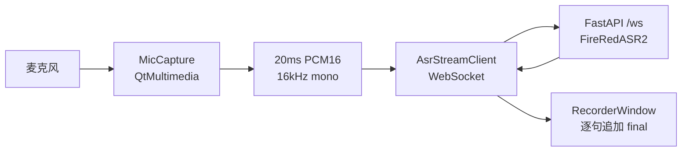
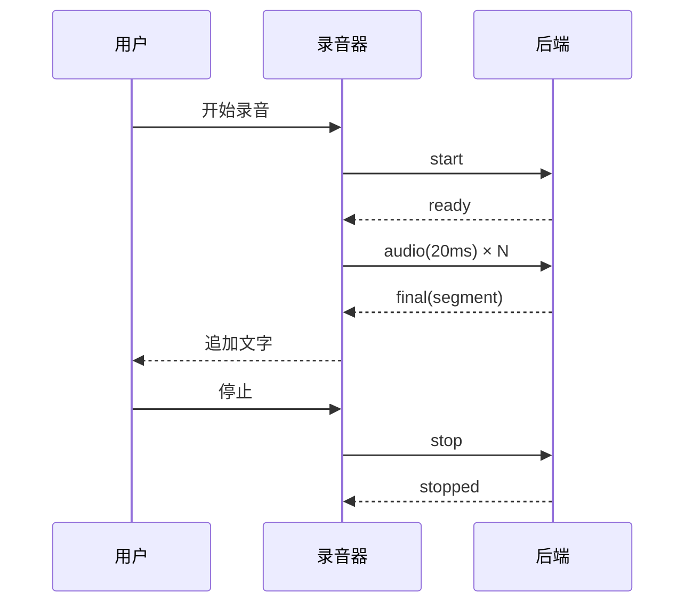

# FireRedASR2S 桌面录音转写器（POC）

> 版本：v1.2
> 目标：在本项目内做一个**独立桌面录音器**：麦克风录音 → WebSocket 推流 → 后端逐句返回文字 → 窗口内流式展示。
> 说明：仅参考 opencode portable launcher 的「窗口 + 内嵌 UI + 与后端解耦」思路；**不引用其代码、依赖或安装包**。

---

## 1. 目标与非目标

### 目标

- 一个可独立运行的窗口程序，不依赖命令行操作。
- 录音格式统一为 **16kHz / 16bit / mono PCM**，每帧 20ms（640B）。
- 连接现有 FastAPI `/ws` 后端，发送 `start` / 音频 / `stop`。
- 后端每返回一条 `final`，窗口立即追加显示；支持 `partial` 草稿（后端暂未发送）。
- 支持配置后端地址、模式（balanced/accuracy）、语言（auto/zh/yue/en）与麦克风设备。

### 非目标（本期）

- 不做逐字流式（后端是句级非流式；文字按句出现）。
- 不做本地后端自动启动（录音器只做客户端；后端需先运行）。
- 不做降噪、回声消除、说话人分离。
- 不做安装包与自动更新（先保证源码可跑通）。

---

## 2. 架构



交互时序：



**分层原则**：录音器只负责采集、推流、展示；模型与切分全在后端。二者通过 WebSocket 协议解耦，换后端不影响窗口。

---

## 3. MVP 功能

| 编号 | 功能 |
| --- | --- |
| R1 | 窗口内开始/停止录音，显示录音时长与电平 |
| R2 | 麦克风设备下拉选择；格式不支持时自动用设备首选格式并重采样到 16k |
| R3 | 20ms PCM 帧经 WebSocket 发送 |
| R4 | 逐条追加 `final` 文本，带句级时间戳 |
| R5 | 显示连接/录音/错误状态；后端断开时提示 |
| R6 | 清空、复制转写结果 |
| R7 | 无窗口 `--file` 模式，便于自动化测试与无麦克风环境验证 |

---

## 4. 协议

与 `docs/POC.md` 的 WebSocket 协议一致。

**客户端 → 服务端**

| 类型 | 载荷 |
| --- | --- |
| `start` | `{"type":"start","sample_rate":16000,"format":"pcm_s16le","mode":"balanced","lang":"auto","output_script":"simplified"}` |
| `audio` | 二进制 PCM（20ms = 640B） |
| `stop` | `{"type":"stop"}` |

**服务端 → 客户端**

| 类型 | 载荷 |
| --- | --- |
| `ready` | `{"type":"ready","session_id":"..."}` |
| `final` | `{"type":"final","segment_id":1,"text":"...","start_ms":0,"end_ms":3200}` |
| `partial`（可选） | `{"type":"partial","text":"..."}` |
| `error` | `{"type":"error","code":"...","message":"..."}` |
| `stopped` | `{"type":"stopped"}` |

> 当前后端只发 `final`；录音器已预留 `partial` 展示位。

---

## 5. 运行方式

先启动后端：

```bash
PYTHONPATH=src python3 -m firered_poc.server --config configs/app.yaml
```

再启动窗口录音器：

```bash
python3 -m pip install --user -r requirements-recorder.txt
PYTHONPATH=src python3 -m firered_recorder
```

默认后端地址：`ws://127.0.0.1:8000/ws`，可在窗口内修改。

### 5.1 前后端不同机（推荐部署）

后端启动时会打印监听信息，例如：

```text
==================================================================
 FireRedASR2S ASR backend
 ASR backend : firered_aed
 VAD backend : silero
 Postprocess : punctuation=True itn=True script=simplified

 WebSocket endpoints:
   ws://127.0.0.1:8000/ws
   ws://192.168.1.20:8000/ws

 Health check:
   http://192.168.1.20:8000/health
==================================================================
```

**后端机**

```bash
PYTHONPATH=src python3 -m firered_poc.server --config configs/app.yaml
```

- `configs/app.yaml` 的 `server.host` 必须是 `0.0.0.0`（默认已配置）。
- 防火墙放行 8000/TCP：
  - Linux：`sudo ufw allow 8000/tcp`
  - Windows：`New-NetFirewallRule -DisplayName "FireRed ASR" -Direction Inbound -LocalPort 8000 -Protocol TCP -Action Allow`
- 在录音器所在机器先用浏览器访问 `http://<后端IP>:8000/health`，确认连通。

**录音器机**

- 后端地址填 `ws://<后端IP>:8000/ws`，不要用 `127.0.0.1`。
- 点「开始录音」后先建立 WebSocket；收到 `ready` 才真正打开麦克风，连不上不会白录。
- 带宽约 256 kbps（16kHz × 16bit），普通局域网足够。

> 跨公网时不要直接暴露裸 WS；应加 WSS/反向代理/鉴权。当前 POC 只面向可信局域网。

无麦克风/无窗口验证（把 WAV 当麦克风流）：

```bash
PYTHONPATH=src python3 -m firered_recorder \
  --url ws://127.0.0.1:8000/ws \
  --file models/sherpa-onnx-fire-red-asr2-ctc-zh_en-int8-2026-02-25/test_wavs/0.wav \
  --no-realtime
```

---

## 6. 音频采集

- 首选请求 `16kHz / mono / Int16`。
- 设备不支持时使用 `preferredFormat()`，自动：
  - Int16 / Int32 / Float / UInt8 → float32；
  - 多声道混为单声道；
  - 任意采样率重采样到 16kHz；
  - 按 320 samples（20ms）切帧并转 Int16。
- 电平条按帧 RMS 计算，仅作提示，不影响识别。

---

## 7. 代码结构

```text
src/firered_recorder/
├── app.py          # PyQt6 窗口、麦克风采集、客户端线程
├── audio.py        # 格式转换 / 重采样 / 分帧 / 电平
├── client.py       # WebSocket 客户端与协议
├── file_stream.py  # WAV 文件模拟推流
├── cli.py          # GUI / 文件模式入口
└── __main__.py
requirements-recorder.txt
tests/unit/test_recorder_*.py
tests/integration/test_recorder_file.py
tests/gui/test_recorder_window.py
```

---

## 8. 验证结果

| 检查 | 结果 |
| --- | --- |
| `ruff check .` | PASS |
| `pytest` | **36 passed**（含录音器协议、音频转换、GUI 冒烟、真实后端文件推流） |
| GUI 冒烟 | offscreen 渲染 980×680 窗口，截图 `/tmp/opencode/recorder-window.png` |
| 文件模式 E2E | 真实后端返回 2 条 `final`：`昨天是MONDAY。` / `TODAY IS礼拜二。THE DAY AFTER TOMORROW是星期三。` |

> 当前容器没有真实麦克风语音输入；麦克风链路以「格式转换 + QtMultimedia 设备枚举 + offscreen GUI」验证，真机录音需在 Windows/Linux 桌面手动冒烟。

---

## 9. 打包（已提供脚本）

PyInstaller 不支持跨平台构建：**Windows exe 必须在 Windows 上构建**（或走 GitHub Actions）。

### 9.1 Windows 本地构建

```powershell
cd FireRedASR2S
py -3.10 -m venv .venv-build
.\.venv-build\Scripts\Activate.ps1
python -m pip install -U pip
pip install -r requirements-recorder.txt pyinstaller
python scripts\build_recorder.py
```

产物：

```text
dist\FireRedRecorder\FireRedRecorder.exe
dist\FireRedRecorder\...
```

把整个 `dist\FireRedRecorder` 目录压缩分发；双击 `FireRedRecorder.exe` 即可。
需要单文件版时：

```powershell
python scripts\build_recorder.py --onefile
```

产物为 `dist\FireRedRecorder.exe`（启动稍慢，体积更大）。

### 9.2 GitHub Actions（推荐，无需 Windows 机器）

仓库已提供 `.github/workflows/build-recorder.yml`：

1. push 代码到 GitHub；
2. 打开 Actions → `build-recorder` → Run workflow；
3. 下载 artifact `FireRedRecorder-windows`（zip）。

### 9.3 说明

- 打包只包含录音器客户端，**不包含后端与模型**；后端仍需单独运行。
- `--collect-all PyQt6` 会带上 QtMultimedia/FFmpeg 插件，体积较大但最稳。
- 未做代码签名；Windows 首次运行可能提示 SmartScreen，选择「更多信息 → 仍要运行」。
- 后端可继续用 Python 源码运行；后续可再打包后端 sidecar。

---

## 10. 限制与后续

- **句级展示**：文字一句一句出现，不是逐字；要逐字需后端加 `partial`。
- **后端需先运行**：录音器不自动拉起 Python 服务。
- **平台音频后端**：QtMultimedia 在 Linux 依赖 PipeWire/GStreamer；容器内会打印缺失警告，但 offscreen UI 正常。Windows 使用系统音频栈。
- **未做**：托盘/快捷键、录音文件保存、断线重连、自动重连、打包安装包。
- **未验证**：真实麦克风长时录音、设备热插拔、48k/立体声设备兼容性。
